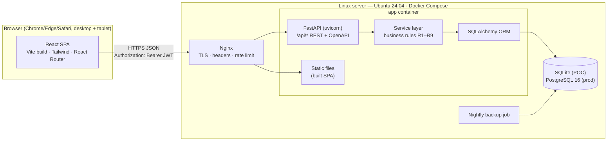
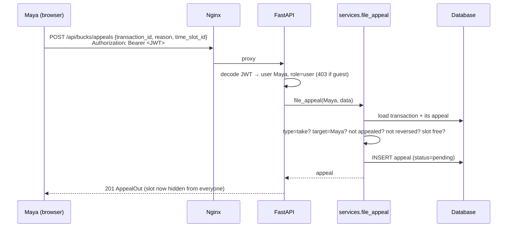
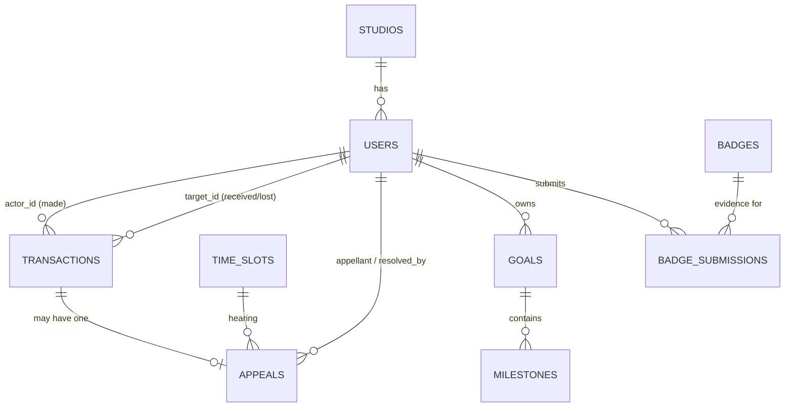

# Revel Journey Tracker — Technical Requirements & Architecture

| | |
|---|---|
| **Project** | Revel Journey Tracker (replacement for Acton Academy's Journey Tracker) |
| **Client** | Revel Academy — *AI Innovation Challenge: Reimagining the Learner Journey* |
| **Document version** | 1.0 — 2026-11-12 |
| **Status** | Draft for review · POC implemented (see §12) |
| **Sources** | Challenge brief ("TZ"), learner's Gemini design chats (Oct 28 – Nov 5, 2026), Gemini React prototype `App.jsx` |

---

## Table of contents

1. [Purpose and scope](#1-purpose-and-scope)
2. [Technology decisions (summary)](#2-technology-decisions-summary)
3. [Architecture](#3-architecture)
4. [Functional requirements](#4-functional-requirements)
5. [Roles and permissions (RBAC)](#5-roles-and-permissions-rbac)
6. [Data model](#6-data-model)
7. [API specification](#7-api-specification)
8. [Authentication and security](#8-authentication-and-security)
9. [Non-functional requirements](#9-non-functional-requirements)
10. [Hosting and operations (Linux)](#10-hosting-and-operations-linux)
11. [Open questions for the learner / school](#11-open-questions-for-the-learner--school)
12. [Implementation plan — tasks](#12-implementation-plan--tasks)
13. [Appendix: POC quick start](#13-appendix-poc-quick-start)

---

## 1. Purpose and scope

### 1.1 Problem
Since Revel Academy became independent from Acton Academy, learners lost access to **Journey Tracker** — the platform where they tracked progress, set goals and earned badges.

### 1.2 Goal
A web application that lets learners take ownership of their learning journey:

| # | Capability (from the brief) | Module |
|---|---|---|
| G1 | **Set & track goals** — create personal goals, monitor progress, celebrate milestones | Weekly Tracking |
| G2 | **Discover & earn badges** — see available badges, the skills they represent and what is required | Badge Catalog |
| G3 | **Build a badge portfolio** — store, organize and showcase earned badges | Hero Portfolio |
| G4 | **Revel Bucks economy** — studio currency with give/take, ledger and Council appeals (added by the learner in the Gemini chats) | Revel Bucks |
| G5 | Make learning personalized and motivating, using AI where it helps ("Big Challenge") | §4.8, Phase 4 |

### 1.3 Out of scope for v1
Grades/report cards, parent messaging, payments, mobile native apps (the web app is responsive instead), integrations with Acton's old system (no data migration available).

### 1.4 Glossary
| Term | Meaning |
|---|---|
| **Learner / Hero** | A student. Role `user`. |
| **Guide** | A teacher/staff member. Role `admin`. |
| **Council** | Learners appointed by a Guide to decide Revel Bucks appeals. A flag (`is_council`) on a learner. |
| **Revel Bucks (RB)** | Studio currency (called "Hero Bucks" at Acton). |
| **Give / Take** | A transaction that adds RB to, or removes RB from, a learner. |
| **Appeal** | A request by the learner whose RB were taken to reverse that transaction, decided at a hearing time slot. |
| **Studio** | A class group (e.g. "Launchpad"). |

---

## 2. Technology decisions (summary)

| Concern | Decision | Why |
|---|---|---|
| **Server OS** | **Linux — Ubuntu Server 24.04 LTS** (x86-64 or ARM64) | Free, supported until 2029 (2034 with Pro), first-class Docker/Python/Nginx support, cheap to host (VPS, school server, or Proxmox/vSphere VM). |
| **Runtime packaging** | **Docker + Docker Compose** | One-command deploy, identical on dev laptop and server, easy rollback. |
| **Backend language / framework** | **Python 3.12 + FastAPI** | Python is what the learner already studies; FastAPI gives automatic request validation (Pydantic) and auto-generated API docs (OpenAPI/Swagger), async-capable, very little boilerplate. |
| **ORM / migrations** | **SQLAlchemy 2.0** + **Alembic** (Alembic from Phase 2) | Same code works with SQLite and PostgreSQL; versioned schema migrations. |
| **Database** | **POC: SQLite** (single file) → **Production: PostgreSQL 16** | SQLite = zero setup for the POC. PostgreSQL = concurrent writes, row locking for money-like balances, point-in-time backups. Switching is a `DATABASE_URL` change + migration. |
| **Frontend framework** | **React 19 + Vite** (JavaScript, JSX) | Keeps the Gemini prototype (written in React) — its design and components carry over directly. Vite = instant dev server, small production build. |
| **UI styling** | **Tailwind CSS 4** + **lucide-react** icons | Same as the prototype; light "Journey Tracker" look (slate-50 background, white cards, blue-600 / amber / emerald accents). |
| **Routing (UI)** | React Router 7 | Real URLs per page (`/revel-bucks`, `/portfolio/5`), back button works, shareable portfolio links. |
| **Frontend ↔ backend** | **REST over HTTPS, JSON**, same origin under `/api/*` | Simple, debuggable, cache-friendly; OpenAPI contract at `/api/docs`. No CORS needed in production because Nginx serves UI and API from one domain. |
| **Authentication** | Username + password → **JWT access token** (HS256). POC sends it as `Authorization: Bearer`; production moves to an **httpOnly, Secure, SameSite=Strict cookie** + refresh token. Optional Google Workspace SSO (OIDC) in Phase 4. | Stateless, simple, standard. |
| **Authorization** | **Role-based access control (RBAC)**: `admin`, `user`, `guest` + `is_council` flag. Enforced on the **server** for every endpoint; the UI only hides what a role can't do. | The learner's appeal rules are security rules, so the server must own them. |
| **Password hashing** | PBKDF2-HMAC-SHA256, 600 000 iterations (Python stdlib) → argon2id in production | OWASP-compliant, no native dependencies (installs on Windows ARM64 too). |
| **Reverse proxy / TLS** | **Nginx** + **Let's Encrypt** (certbot) | HTTPS, security headers, login rate limiting, static file caching. |
| **CI/CD** | **GitHub Actions**: lint → tests → build image → push to GHCR → deploy over SSH | Free for small repos; matches the existing GitHub workflow. |
| **Testing** | Backend: **pytest** + FastAPI TestClient. Frontend: Vitest + Playwright (Phase 2). | Business rules (appeals!) must be regression-tested. |

---

## 3. Architecture

### 3.1 Logical view



### 3.2 Layers (backend)

| Layer | Folder / file | Responsibility |
|---|---|---|
| HTTP routers | `backend/app/routers/*.py` | URL → function, parse/validate input, pick the role guard, serialize output. **No business rules.** |
| Schemas | `backend/app/schemas.py` | Pydantic request/response models = the JSON contract. |
| Auth & RBAC | `backend/app/deps.py`, `security.py` | Decode JWT, load current user, `require_roles(...)` guards, password hashing. |
| Services | `backend/app/services.py` | Revel Bucks and appeal rules (R1–R9), computed permissions (`can_appeal`, `can_resolve`). |
| Models | `backend/app/models.py` | SQLAlchemy tables. |
| DB session | `backend/app/database.py` | Engine, session per request, SQLite pragmas. |
| Config | `backend/app/config.py` | All settings from environment variables. |

### 3.3 Frontend structure

| File | Responsibility |
|---|---|
| `src/api.js` | `fetch` wrapper: adds the token, turns errors into messages, logs out on 401. |
| `src/auth.jsx` | `AuthProvider` context: current user, `login`, `loginAsGuest`, `logout`, role helpers. |
| `src/App.jsx` | Header, role-filtered sidebar, routes. |
| `src/components/ui.jsx` | Shared design system: Card, Button, Chip, Modal, Field, ProgressBar, `useLoad` hook. |
| `src/pages/*.jsx` | One file per page: Login, MissionControl, RevelBucks, WeeklyTracking, BadgeCatalog, Portfolio, FellowTravelers, Admin. |

### 3.4 Request flow example — "Maya appeals a take"



### 3.5 Environments

| Env | Where | DB | How it runs |
|---|---|---|---|
| **Dev / POC** | Developer laptop (Windows) | SQLite file `backend/journey.db` | `scripts\run.ps1 -Dev` → uvicorn `:8000` + Vite `:5173` (Vite proxies `/api`). |
| **Staging** | Small Linux VM (1 vCPU / 1 GB) | PostgreSQL container | `docker compose up -d`; demo data on. |
| **Production** | Linux VM/VPS (2 vCPU / 2 GB / 20 GB SSD is plenty for one school) | PostgreSQL + nightly backups | Docker Compose, Nginx + Let's Encrypt, demo data off. |

---

## 4. Functional requirements

Priority: **M** = must (MVP), **S** = should, **C** = could. "POC" = implemented in the proof of concept.

### 4.1 Accounts & sign-in (FR-AUTH)

| ID | Requirement | Pri | POC |
|---|---|---|---|
| FR-AUTH-1 | Users sign in with username + password. Wrong user and wrong password give the same message. | M | ✅ |
| FR-AUTH-2 | "Continue as guest" signs in to a shared read-only guest account (can be disabled by config). | M | ✅ |
| FR-AUTH-3 | Session expires after a configurable time (default 120 min); the UI returns to login on expiry. | M | ✅ |
| FR-AUTH-4 | Guides create accounts, reset passwords, change roles, disable accounts. Accounts are never hard-deleted (ledger history must stay intact). | M | ✅ (reset via API) |
| FR-AUTH-5 | Learners can change their own password; first login forces a password change. | S | — |
| FR-AUTH-6 | Sign in with Google Workspace (school accounts) via OpenID Connect. | C | — |

### 4.2 Mission Control dashboard (FR-DASH)

| ID | Requirement | Pri | POC |
|---|---|---|---|
| FR-DASH-1 | Shows Revel Bucks balance, streak, level + XP progress bar, badges earned. | M | ✅ |
| FR-DASH-2 | Quick links: weekly goals (active/done counts), badge catalog (in review count), portfolio, appeals (pending count). | M | ✅ |
| FR-DASH-3 | Recent Revel Bucks activity (last 5). | S | ✅ |
| FR-DASH-4 | Streak is calculated from daily check-ins (not stored manually). | S | — (seeded value) |
| FR-DASH-5 | Level = `XP ÷ 1000 + 1`. | M | ✅ |

### 4.3 Weekly Tracking — goals (FR-GOAL)

| ID | Requirement | Pri | POC |
|---|---|---|---|
| FR-GOAL-1 | A learner creates goals: title, why it matters, category (Core Skills, Quest Badges, Deep Books, Civilization, Life Skills), type (daily/weekly/session), target date, milestones. | M | ✅ |
| FR-GOAL-2 | Milestones can be added and ticked/unticked; progress % = done ÷ total. | M | ✅ |
| FR-GOAL-3 | Reaching 100% marks the goal "Achieved 🎉" and grants **+50 XP** (taken back if un-ticked). | M | ✅ |
| FR-GOAL-4 | Goals are private to the learner (Guides see them in Phase 2 for coaching). | M | ✅ (owner only) |
| FR-GOAL-5 | Goals can be deleted by their owner. | M | ✅ |
| FR-GOAL-6 | Socratic discussion log and daily check-in/check-out. | C | — |

### 4.4 Badge Catalog (FR-BADGE)

| ID | Requirement | Pri | POC |
|---|---|---|---|
| FR-BADGE-1 | Catalog lists every active badge: icon, title, category, XP, description, skills, criteria checklist, number of learners who earned it. | M | ✅ |
| FR-BADGE-2 | Search by text/skill and filter by category. | M | ✅ |
| FR-BADGE-3 | A learner submits evidence (optional link + required reflection). Status becomes **In Review**. One active submission per badge per learner. | M | ✅ |
| FR-BADGE-4 | A Guide reviews: **Award** (status Earned, +badge XP) or **Needs more work** (with feedback; learner can resubmit). | M | ✅ |
| FR-BADGE-5 | Guides create/edit/retire badges in the UI. | S | API only (`POST /api/badges`) |
| FR-BADGE-6 | File upload for evidence (images/PDF, ≤5 MB, virus-scanned) instead of only links. | C | — |
| FR-BADGE-7 | Prerequisite badges (badge B requires badge A). | C | — |

### 4.5 Hero Portfolio (FR-PORT)

| ID | Requirement | Pri | POC |
|---|---|---|---|
| FR-PORT-1 | Shows a learner's earned badges with reflection, evidence link and date, level/XP, count per category, and all skills demonstrated. | M | ✅ |
| FR-PORT-2 | Learners land on their own portfolio; Guides and guests pick a learner. Clicking a learner in Fellow Travelers opens their portfolio. | M | ✅ |
| FR-PORT-3 | Export portfolio to PDF ("official transcript"). | S | — |
| FR-PORT-4 | Public share link with an expiry, for family. | C | — |

### 4.6 Revel Bucks (FR-RB) — as specified by the learner

The page has a header (your balance + **Make a Transaction** button) and **4 tabs**:

| ID | Requirement | Pri | POC |
|---|---|---|---|
| FR-RB-1 | **My Revel Bucks** tab: scrollable list of your transactions, newest first; who gave/took, amount (+/−), date. Clicking an entry shows the full reason; an **Appeal** button sits at the bottom of the explanation when you're allowed to appeal. | M | ✅ |
| FR-RB-2 | **Make a Transaction**: choose a learner, *give* or *take*, amount (1–500), and the reason (required). | M | ✅ |
| FR-RB-3 | **Studio Balances** tab: every learner and their balance; **Guides are excluded**. Clicking a learner opens their ledger **read-only** (can scroll and open entries, cannot transact or appeal). | M | ✅ |
| FR-RB-4 | **Studio Transactions** tab: every transaction since the studio started, all details shown inline (no "inspect" click). | M | ✅ |
| FR-RB-5 | **Appeals** tab: all *pending* appeals; when resolved they leave the list. Each shows original reason, **the appellant's written reason**, hearing time, appellant and initiator. | M | ✅ |
| FR-RB-6 | A reversed transaction is shown **faded and struck-through but never disappears**. | M | ✅ |
| FR-RB-7 | After resolution anyone opening the transaction sees a small "Appeal approved/denied (by whom)" note. | M | ✅ |
| FR-RB-8 | Studio-wide statistics (most generous, weekly totals). | C | — |

#### Business rules (enforced in `services.py`, covered by `tests/test_rules.py`)

| Rule | Description |
|---|---|
| **R1** | Signed-in learners and Guides can give or take; guests cannot. |
| **R2** | No transactions with yourself, and only learners can be the *target* (Guides and guests have no meaningful balance). |
| **R3** | Learner **give**: bucks move from giver to target (giver needs enough). Learner **take**: bucks move from target to taker. **Guides mint/burn**: a Guide's give creates bucks, a Guide's take removes them — the Guide's own balance never changes. |
| **R4** | A take can't push a learner below 0 RB. |
| **R5** | **Give transactions can never be appealed.** |
| **R6** | **A take can only be appealed by the person it was taken from.** If Liam takes from Maya, *only Maya* sees the Appeal button; Liam never does (he takes part in the hearing as "Initiator"). One appeal per transaction; not after reversal. |
| **R7** | Filing an appeal requires choosing a hearing **time slot**. A booked slot **disappears** from everyone's options and **comes back** automatically when the appeal is approved or denied. (Implemented as "available = active and not used by a pending appeal", so slots can't get lost.) |
| **R8** | Appeals are decided by **Council members** (learners appointed by a Guide) **or Guides**. A Council member **can't decide an appeal they're part of** (appellant or initiator). |
| **R9** | **Approve** → the transaction is reversed (the exact opposite of the balance changes it caused) and shown faded. **Deny** → it stands. Both free the time slot. |

> ⚠️ One instruction in the chats conflicts with R6 — see open question **Q1** (§11). It is implemented as a config switch `APPEALS_REQUIRE_COUNCIL`.

### 4.7 Fellow Travelers & Guide Console (FR-ADMIN)

| ID | Requirement | Pri | POC |
|---|---|---|---|
| FR-ADMIN-1 | Fellow Travelers: directory of learners and Guides with role/Council tags; learners link to their portfolio. | M | ✅ |
| FR-ADMIN-2 | Guide Console → **Badge Reviews** queue with feedback. | M | ✅ |
| FR-ADMIN-3 | Guide Console → **Users & Council**: create account, change role, toggle Council ON/OFF (replaces the prototype's self-service toggle, which let anyone make themselves Council), enable/disable. A Guide can't demote/disable themselves. | M | ✅ |
| FR-ADMIN-4 | Guide Console → **Hearing Times**: add/retire slots, see booked vs available. | M | ✅ |
| FR-ADMIN-5 | Audit log of admin actions (role changes, password resets, appeal decisions). | S | — (appeal decisions recorded) |
| FR-ADMIN-6 | CSV import of learners at the start of a session. | S | — |
| FR-ADMIN-7 | Multiple studios with per-studio ledgers. | C | data model ready (`studios` table) |

### 4.8 AI features (the "Big Challenge") — Phase 4

The learner deliberately removed the Socratic AI chat from the prototype, so v1 ships without AI. AI is used in *building* the product (design was prototyped with Gemini). Candidate features for later, each behind a feature flag, with **no learner data sent to third parties without school consent**:

| ID | Idea | Notes |
|---|---|---|
| FR-AI-1 | "Break my goal into milestones" suggestion button | Learner accepts/edits suggestions; never auto-saves. |
| FR-AI-2 | Badge recommender: "badges that match your goals and skills" | Can be rule-based first (skills overlap), AI later. |
| FR-AI-3 | Reflection coach: asks one Socratic question about a draft reflection | Must not write the reflection for the learner. |
| — | Hosting option | Self-hosted model (e.g. Ollama on the same server) keeps data in-house; or a cloud API under a school data-processing agreement. |

---

## 5. Roles and permissions (RBAC)

| Capability | Guest | Learner | Learner + Council | Guide (admin) |
|---|:-:|:-:|:-:|:-:|
| Mission Control | ✅ (limited) | ✅ | ✅ | ✅ |
| Badge catalog (view) | ✅ | ✅ | ✅ | ✅ |
| Submit badge evidence | — | ✅ | ✅ | — |
| Review badge evidence / create badges | — | — | — | ✅ |
| Hero portfolios (view) | ✅ | ✅ | ✅ | ✅ |
| Own goals (CRUD) | — | ✅ | ✅ | — |
| Studio Balances | ✅ | ✅ | ✅ | ✅ |
| Read-only ledger of a learner | — | ✅ | ✅ | ✅ |
| Studio Transactions / Appeals list | — | ✅ | ✅ | ✅ |
| Make a transaction | — | ✅ (moves own bucks) | ✅ | ✅ (mint/burn) |
| File an appeal | — | ✅ *only on takes from me* | ✅ *only on takes from me* | — |
| Approve / deny appeals | — | — | ✅ *unless a party* | ✅ |
| Accounts, roles, Council, hearing times | — | — | — | ✅ |

Enforcement: each endpoint declares `Depends(require_roles(...))`; per-object rules (R6, R8) are checked in `services.py`. The API also returns computed flags (`can_appeal`, `can_resolve`) so the UI shows exactly the buttons the server will accept.

---

## 6. Data model



| Table | Key columns | Notes |
|---|---|---|
| `studios` | id, name | |
| `users` | id, username (unique), password_hash, display_name, avatar, **role** (`admin`/`user`/`guest`), **is_council**, is_active, studio_id, **balance**, xp, streak, top_skill, created_at | `level` computed from xp. Never hard-deleted. |
| `transactions` | id, actor_id, target_id, **type** (`give`/`take`), amount, reason, **actor_delta**, **target_delta**, **is_reversed**, created_at | Append-only ledger. Deltas store the exact balance changes so a reversal is always the precise inverse (works for Guide mint/burn). |
| `appeals` | id, transaction_id (**unique**), appellant_id, reason, time_slot_id, **status** (`pending`/`approved`/`denied`), submitted_at, resolved_at, resolved_by_id | One appeal per transaction. |
| `time_slots` | id, label (unique), is_active | "Booked" is derived from pending appeals — no flag to get out of sync. |
| `goals` | id, owner_id, title, description, category, period, target_date, created_at | |
| `milestones` | id, goal_id (cascade delete), title, completed | |
| `badges` | id, title (unique), category, icon, xp, description, skills (JSON), criteria (JSON), is_active | JSON columns → `jsonb` on PostgreSQL. |
| `badge_submissions` | id, badge_id, user_id, evidence_url, reflection, **status** (`in_review`/`earned`/`rejected`), feedback, submitted_at, reviewed_at, reviewed_by_id | Unique (badge_id, user_id). |

**Integrity requirements (production):** balance updates and ledger insert in **one DB transaction**; on PostgreSQL use `SELECT … FOR UPDATE` on both user rows to prevent double-spend under concurrency; nightly job asserts `balance == opening_balance + Σ deltas` per user.

---

## 7. API specification

Base path `/api`. JSON in/out. Auth header `Authorization: Bearer <token>` (cookie in production). Errors: `{"detail": "message"}` with 400 (rule broken), 401 (not signed in/expired), 403 (role not allowed), 404, 422 (validation). Full interactive spec: **`/api/docs`** (Swagger UI, generated from code).

| Method & path | Roles | Purpose |
|---|---|---|
| `POST /auth/login` | public | `{username, password}` → `{access_token, user}` |
| `POST /auth/guest` | public | Guest token |
| `GET /auth/me` | any | Current user |
| `GET /dashboard` | any | Mission Control data |
| `GET /people` | any | Fellow Travelers |
| `GET /portfolio/{user_id}` | any | Hero Portfolio |
| `GET /bucks/balances` | any | Studio Balances (learners only) |
| `GET /bucks/transactions?scope=mine\|studio\|user&user_id=` | learner, guide | Ledgers (each item has `can_appeal`) |
| `POST /bucks/transactions` | learner, guide | `{target_id, type, amount, reason}` |
| `GET /bucks/time-slots` | learner, guide | Free hearing slots |
| `GET /bucks/appeals?status=pending\|approved\|denied\|all` | learner, guide | Appeals (each has `can_resolve`) |
| `POST /bucks/appeals` | learner | `{transaction_id, reason, time_slot_id}` |
| `POST /bucks/appeals/{id}/resolve` | Council, guide | `{decision: approve\|deny}` |
| `GET/POST /goals` | learner | List / create (with milestones) |
| `PATCH/DELETE /goals/{id}` | learner (owner) | Edit / delete |
| `POST /goals/{id}/milestones` | learner (owner) | Add milestone |
| `POST /goals/{id}/milestones/{mid}/toggle` | learner (owner) | Tick / untick |
| `GET /badges` | any | Catalog (+ my status) |
| `POST /badges` | guide | Create badge |
| `POST /badges/{id}/submissions` | learner | Submit evidence |
| `GET /badges/submissions?status=` | guide | Review queue |
| `POST /badges/submissions/{id}/review` | guide | `{decision: approve\|reject, feedback}` |
| `GET/POST /admin/users`, `PATCH /admin/users/{id}` | guide | Accounts, roles, Council, password reset |
| `GET/POST /admin/time-slots`, `DELETE /admin/time-slots/{id}` | guide | Hearing times |
| `GET /health` | public | Liveness probe |

Versioning: breaking changes go to `/api/v2`; the SPA and API ship together, so v1 can be retired on release.

---

## 8. Authentication and security

### 8.1 How sign-in works (POC)
1. User submits username/password to `POST /api/auth/login`.
2. Server looks up the user, verifies the PBKDF2 hash with a constant-time compare.
3. Server returns a JWT: `{sub: user_id, role, iat, exp}` signed with `JWT_SECRET` (HS256).
4. SPA keeps it in `sessionStorage` and sends `Authorization: Bearer …` on every call.
5. Every request: token signature + expiry checked, user re-loaded from DB (so disabling an account or changing a role takes effect immediately).

### 8.2 Production hardening (Phase 2 tasks)
| Item | Requirement |
|---|---|
| Token storage | Move JWT to an **httpOnly, Secure, SameSite=Strict cookie** (not readable by JavaScript → safe from XSS token theft); short access token (15 min) + rotating refresh token (7 days) stored hashed in DB, revocable on logout/password change. |
| CSRF | SameSite=Strict + require `X-Requested-With`/custom header on state-changing requests. |
| Secrets | `JWT_SECRET` ≥ 64 random chars from `.env` (not in git); DB password likewise. |
| Passwords | Min 8 chars, block top-10k common passwords; argon2id. |
| Brute force | Nginx `limit_req` on `/api/auth/login` (configured: 10/min/IP) + account lockout after 10 failures for 15 min. |
| Transport | HTTPS only (HSTS), TLS 1.2+, Let's Encrypt auto-renew. |
| Headers | CSP (`default-src 'self'`), X-Content-Type-Options, X-Frame-Options DENY, Referrer-Policy. |
| Input | All input validated by Pydantic; React escapes output by default; no raw HTML rendering. |
| Dependencies | Dependabot + `pip-audit`/`npm audit` in CI. |

### 8.3 Children's privacy
Users are minors. Requirements: collect only what is needed (name, avatar, school work — no birthdays/addresses/photos of faces by default); data stays on school-controlled hosting; no ads/trackers/analytics SDKs; guest view shows no transaction reasons or appeals; school confirms consent and retention policy under applicable law (e.g. PIPEDA/Ontario rules in Canada, COPPA/FERPA if US-based); account export and deletion on request (ledger rows anonymized, not deleted).

---

## 9. Non-functional requirements

| ID | Category | Requirement |
|---|---|---|
| NFR-1 | Performance | p95 API latency < 300 ms for 100 concurrent users; first page load < 2 s on school Wi-Fi (current JS bundle ≈ 100 KB gzipped). |
| NFR-2 | Availability | School hours 99.5 %; maintenance windows outside 8 AM–4 PM. |
| NFR-3 | Backups | Nightly DB dump, 14 daily + 8 weekly kept, copied off-server; **restore tested every term**. |
| NFR-4 | Accessibility | WCAG 2.1 AA: keyboard navigation, focus states, color contrast, labels on all inputs, Esc closes dialogs. |
| NFR-5 | Devices | Latest Chrome, Edge, Safari, Firefox; Chromebooks; tablets ≥ 768 px; usable on phones. |
| NFR-6 | Logging | JSON access logs (no passwords/tokens), app error logs, 30-day retention. |
| NFR-7 | Monitoring | `/api/health` checked every minute (Uptime Kuma or similar); disk/CPU alerts. |
| NFR-8 | Maintainability | Code formatted (ruff/black, prettier), ≥ 80 % test coverage on `services.py`, README for setup. |
| NFR-9 | Data integrity | Ledger is append-only; balances reconcilable from deltas (§6). |
| NFR-10 | Time zone | Store UTC, display in the browser's local time. |

---

## 10. Hosting and operations (Linux)

### 10.1 Server baseline — Ubuntu Server 24.04 LTS
1. VM: 2 vCPU, 2 GB RAM, 20 GB SSD (school server, Proxmox/vSphere VM, or a VPS in Canada).
2. Create a sudo user, disable root SSH and password SSH (keys only), `ufw allow 22,80,443`, enable `unattended-upgrades`, install `fail2ban`.
3. Install Docker Engine + Compose plugin from Docker's apt repo.
4. DNS: `journey.revelacademy.<tld>` → server IP.

### 10.2 Deploy
```bash
git clone <repo> /opt/journey-tracker && cd /opt/journey-tracker
cp .env.example .env          # set JWT_SECRET, DATABASE_URL, SEED_DEMO_DATA=false
docker compose up -d --build  # app + nginx
docker compose ps && curl -s localhost/api/health
```
Then add TLS: certbot (webroot or the `nginx` plugin) and a `listen 443 ssl` server block; redirect 80 → 443.

### 10.3 Upgrades & rollback
CI builds `ghcr.io/<org>/journey-tracker:<git-sha>`; deploy = `docker compose pull && docker compose up -d`; Alembic migration runs on container start; rollback = previous image tag (+ `alembic downgrade` if needed). Take a DB backup before every migration.

---

## 11. Open questions for the learner / school

| # | Question | Current POC choice |
|---|---|---|
| **Q1** | The last Gemini instruction said the Appeal button should show only when the user is **on the Council**. Earlier the rule was "only the person whose bucks were taken can appeal". Should non-Council learners be able to appeal takes from them? | Any learner can appeal takes from them (R6). Set `APPEALS_REQUIRE_COUNCIL=true` to require Council too. |
| Q2 | When a learner *takes* bucks, should they go to the taker (like the prototype) or just disappear? | Go to the taker; Guide takes disappear. |
| Q3 | If an approved appeal reverses a take after the taker already spent the bucks, may their balance go negative? | Yes (shown as negative) — alternative: cap at 0 and log the shortfall. |
| Q4 | Should learners be allowed to take bucks from each other at all, or only Guides/Council? | Allowed (as designed in the chats). |
| Q5 | Daily/weekly limits on give/take amounts to prevent abuse? | Max 500 per transaction only. |
| Q6 | Who is a guest — parents, visitors, competition judges? Should they see balances? | Guests see badge catalog, portfolios, balances; not transaction reasons or appeals. |
| Q7 | Should resolved appeals have a history view (e.g. "Past appeals")? | Visible on each transaction; list via `GET /bucks/appeals?status=all`. |
| Q8 | How is a streak earned — daily check-in, completing a daily goal? | Not computed yet. |
| Q9 | Name: "Revel Bucks" or "Hero Bucks"? | Revel Bucks. |

---

## 12. Implementation plan — tasks

Estimates are for one developer (parent + learner pairing). ✅ = done in the POC.

### Phase 0 — Project setup
| ID | Task | Details | Deliverable | Est. |
|---|---|---|---|---|
| T0.1 ✅ | Create repository | Monorepo `journey-tracker/` with `backend/`, `frontend/`, `docs/`, `deploy/`, `scripts/`; `.gitignore`, `.env.example`. | Repo skeleton | 1 h |
| T0.2 | Push to GitHub, protect `main` | Private repo, PRs required, CODEOWNERS. | GitHub repo | 0.5 h |
| T0.3 ✅ | Dev environment scripts | `scripts/setup.ps1` (venv + npm), `scripts/run.ps1` (single-process or `-Dev` hot reload). | Working local env | 1 h |
| T0.4 | Editor tooling | ruff + black (Python), prettier + eslint (JS), pre-commit hooks. | Consistent formatting | 1 h |

### Phase 1 — Proof of concept ✅
| ID | Task | Details | Est. |
|---|---|---|---|
| T1.1 ✅ | Backend skeleton | FastAPI app, settings from env, SQLAlchemy engine/session, SQLite pragmas (FKs, WAL), `/api/health`, OpenAPI at `/api/docs`. | 2 h |
| T1.2 ✅ | Data model | 9 tables per §6; `create_all` on startup. | 2 h |
| T1.3 ✅ | Auth | PBKDF2 hashing, JWT issue/verify, `/auth/login`, `/auth/guest`, `/auth/me`, `require_roles` guards. | 3 h |
| T1.4 ✅ | Revel Bucks service | Rules R1–R9 in `services.py`; transactions, balances, ledgers with `can_appeal`. | 4 h |
| T1.5 ✅ | Appeals + time slots | File/resolve appeals, derived slot availability, reversal via deltas, conflict-of-interest check. | 3 h |
| T1.6 ✅ | Goals & milestones | CRUD, progress, +50 XP on completion. | 2 h |
| T1.7 ✅ | Badges | Catalog with my-status, submissions, Guide review, XP award. | 3 h |
| T1.8 ✅ | Admin endpoints | Users/roles/Council, time slots. | 2 h |
| T1.9 ✅ | Demo seed data | Alex, Maya, Liam, Sophia, Jackson, Guide Sarah, guest; history incl. a pending and an approved appeal. | 1 h |
| T1.10 ✅ | Business-rule tests | 12 pytest tests (login, guest read-only, appeal permissions, slot recycling, reversal, Council conflict, goals, badges). | 2 h |
| T1.11 ✅ | Frontend shell | Vite + React + Tailwind, `api.js`, `AuthProvider`, router, role-filtered sidebar, header (role chip, Council badge, balance, streak, logout). | 3 h |
| T1.12 ✅ | Login page | Username/password, guest button, demo-account shortcuts. | 1 h |
| T1.13 ✅ | Revel Bucks page | Header + 4 tabs, transaction/appeal modals, read-only member ledger, faded reversed rows. | 5 h |
| T1.14 ✅ | Other pages | Mission Control, Weekly Tracking, Badge Catalog, Hero Portfolio, Fellow Travelers, Guide Console. | 6 h |
| T1.15 ✅ | Packaging | Dockerfile (multi-stage), docker-compose with Nginx. | 1 h |

### Phase 2 — MVP hardening (before real learners use it)
| ID | Task | Details | Est. |
|---|---|---|---|
| T2.1 | Show POC to the learner & school; answer Q1–Q9 | Record decisions in this doc. | 2 h |
| T2.2 | PostgreSQL | Add `psycopg[binary]`; compose service `db: postgres:16` with volume; row locks for balance updates. | 3 h |
| T2.3 | Alembic migrations | Initial migration from models; run on container start; remove `create_all`. | 2 h |
| T2.4 | Cookie-based auth + refresh tokens | §8.2; logout revokes refresh token. | 4 h |
| T2.5 | Password change & first-login reset | FR-AUTH-5; admin "reset password" button in UI. | 2 h |
| T2.6 | Login lockout + audit log | FR-ADMIN-5; `audit_log` table. | 3 h |
| T2.7 | Badge admin UI | Create/edit/retire badges, criteria editor (FR-BADGE-5). | 4 h |
| T2.8 | CSV learner import | FR-ADMIN-6. | 2 h |
| T2.9 | Frontend tests | Vitest for components; Playwright E2E: login per role, give/take, appeal → approve. | 4 h |
| T2.10 | Accessibility pass | NFR-4: keyboard, focus trap in modals, contrast, aria labels; axe scan. | 3 h |
| T2.11 | GitHub Actions CI | Jobs: ruff, pytest, `npm ci && npm run build`, Playwright, `docker build`; push image to GHCR on `main`. | 3 h |

### Phase 3 — Linux deployment
| ID | Task | Details | Est. |
|---|---|---|---|
| T3.1 | Provision Ubuntu 24.04 VM | §10.1 hardening steps. | 2 h |
| T3.2 | Domain + TLS | DNS record, certbot, 443 server block, HSTS. | 1 h |
| T3.3 | Deploy with Compose | `.env` with real secrets, `SEED_DEMO_DATA=false`, create first Guide account. | 1 h |
| T3.4 | Backups | Nightly `pg_dump` cron → off-site (e.g. S3-compatible/NAS); restore drill. | 2 h |
| T3.5 | Monitoring | Uptime Kuma on `/api/health`, disk alerts, log rotation. | 1 h |
| T3.6 | CD | GitHub Actions deploy job over SSH (`docker compose pull && up -d`) on tagged releases. | 2 h |
| T3.7 | Pilot | One studio for 2 weeks; collect feedback from learners and Guides. | — |

### Phase 4 — Enhancements
| ID | Task | Est. |
|---|---|---|
| T4.1 | Streaks from daily check-in / check-out (FR-DASH-4, FR-GOAL-6) | 4 h |
| T4.2 | Portfolio PDF export (FR-PORT-3) and share links (FR-PORT-4) | 4 h |
| T4.3 | Evidence file uploads with size/type limits (FR-BADGE-6) | 4 h |
| T4.4 | Notifications (in-app): "your appeal was decided", "badge awarded" | 4 h |
| T4.5 | Google Workspace SSO (FR-AUTH-6) | 4 h |
| T4.6 | AI features FR-AI-1…3 behind feature flags, self-hosted model option | 8–16 h |
| T4.7 | Multiple studios (FR-ADMIN-7) | 6 h |
| T4.8 | Peer 360 reviews & Hero Bucks tipping (from the prototype's "Fellow Travelers") | 6 h |

---

## 13. Appendix: POC quick start

```powershell
cd C:\Projects\journey-tracker
powershell -ExecutionPolicy Bypass -File scripts\setup.ps1   # once
powershell -ExecutionPolicy Bypass -File scripts\run.ps1     # http://localhost:8000
# or hot-reload dev mode: scripts\run.ps1 -Dev               # http://localhost:5173
```

| Account | Password | Role |
|---|---|---|
| `alex` | `revel123` | Learner, Council |
| `maya`, `sophia`, `jackson` | `revel123` | Learner |
| `liam` | `revel123` | Learner, Council |
| `sarah` | `guide123` | Guide (admin) |
| `admin` | `admin123` | Admin |
| *Continue as guest* | — | Guest (read-only) |

Reset demo data: stop the server, delete `backend\journey.db*`, start again.
